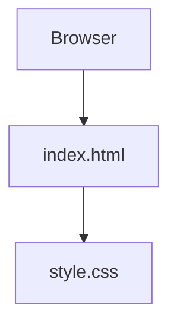

<a id="top"></a>

<div align="center">

# 📊 UpStat

**A minimal static web starting point for the UpStat interface.**


[Repository](https://github.com/ashishgiije/UpStat) · [Overview](#overview) · [Architecture](#architecture) · [Setup](#setup) · [Validation](#testing-and-validation) · [Audit](AUDIT_REPORT.md)

</div>

## Overview

The checkout currently contains a single page displaying the UpStat heading. It is an early interface scaffold: no uptime monitoring, analytics collection, API, database, or account system is implemented. It provides a small starting point for learning and extending a static website.

## Visual preview

**Screenshot placeholder:** No verified application screenshot is supplied here. Capture the static heading in a browser. No image is fabricated.

## Key features

- HTML document with viewport metadata and a linked stylesheet.
- A visible UpStat header.

## Technology stack

| Technology | Role in this checkout |
|---|---|
| HTML5 | Page structure |
| CSS | Page styling |
| JavaScript | Empty script placeholder |

## Architecture



## Application workflow

Open the page → load its stylesheet → display the heading. `script.js` is empty and is not loaded by the HTML.

## Setup

```bash
git clone https://github.com/ashishgiije/UpStat.git
cd UpStat
```

Python 3 is sufficient to serve the files; no package installation is required.

```bash
python3 -m http.server 8080 --bind 127.0.0.1
```

Open `http://127.0.0.1:8080`. A static host can serve the same files; no deployment configuration is included.

## Project structure

```text
index.html     # Page and heading
style.css      # Stylesheet
script.js      # Empty JavaScript file
```


## Testing and validation

Current source review and checks (4 November 2026):

Static source inspected; HTTP smoke check pending at documentation generation. HTTP GET / returned 200 and expected page content

Use the setup commands above and the documented workflow for a local smoke check. No passing automated application suite is claimed where none exists.

## Limitations and roadmap

- Implemented: static heading and stylesheet.
- Planned suggestions: define the product scope, then build monitoring or dashboard functionality if desired.
- No automated tests, server-side logic, or data persistence are present.

<details>
<summary>Troubleshooting and contributions</summary>

Check the runtime versions and working directory first. For dependency installation failures, preserve TLS and checksum verification and inspect the first error. For external services, verify your local configuration and account permissions without sharing secret values.

Before contributing, read [the audit](AUDIT_REPORT.md), reproduce the affected behavior, and keep documentation changes separate from application fixes. Add tests for changed behavior and describe remaining limitations accurately.

</details>

## Author

**Ashish Gije** · [GitHub](https://github.com/ashishgiije)

[Back to top](#top)
